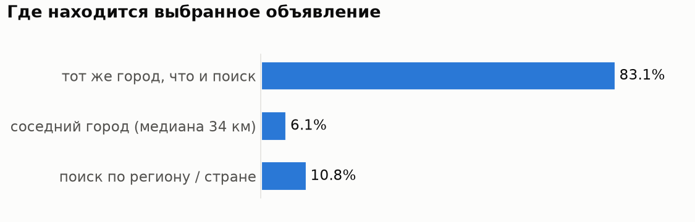
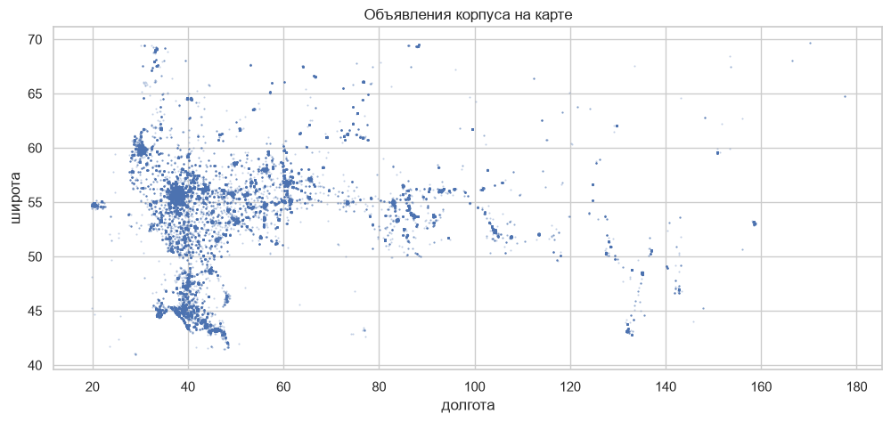
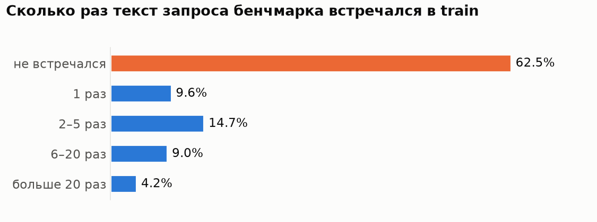
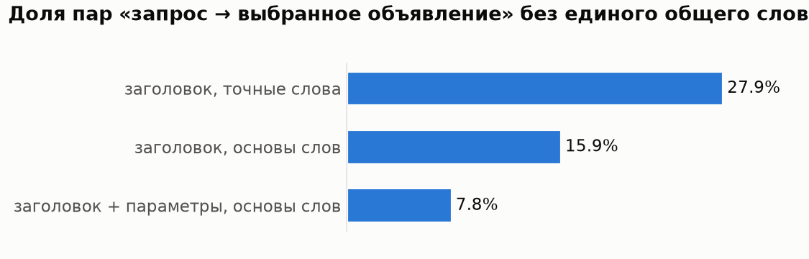
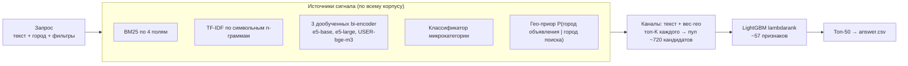
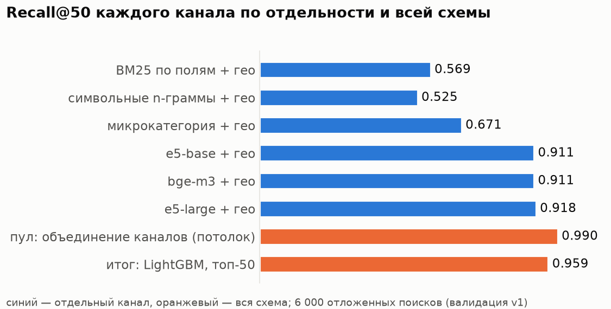
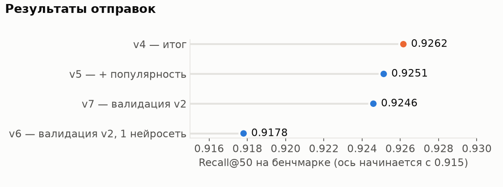
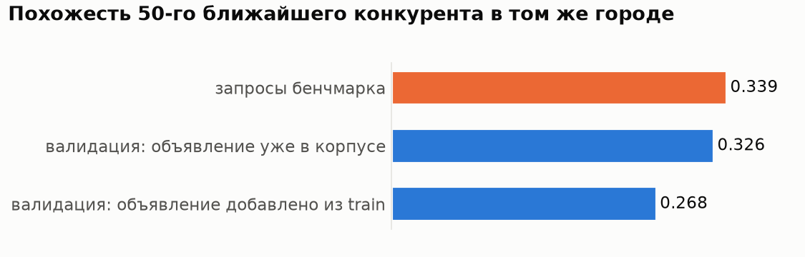

# Кандидатогенерация для поиска услуг Авито

**Итог: Recall@50 = 0.926 на бенчмарке** (`answer.csv`).

Задача: по поисковому запросу (текст, локация, фильтры) выбрать из корпуса 189 212 объявлений до 50 кандидатов так,
чтобы среди них оказалось объявление, которое пользователь в итоге выбрал. Метрика — Recall@50.

Код и выполненные ноутбуки воспроизводят именно отправленный ответ (версия v4). Все эксперименты, которые не вошли
в итог, лежат отдельно в `experiments/` и описаны ниже вместе с причинами, почему их не взял.

Ссылка на веса: https://mega.nz/file/sd9HwbTa#onaj6Pk_fRsAb5psgrEuAojCSLeFh7qchlM52JO1bnw

---

## 1. С чего я начал

**Метрика.** Recall@50 не смотрит на порядок внутри топ-50, только на то, попало ли нужное объявление в список.
Отсюда главный принцип всего решения: **задача — не потерять нужное объявление**, а не найти «самое лучшее».

**Как устроен поиск в Авито.** Перед решением я посмотрел доклад Ильи Валяева (Data Science Team Lead поискового
ранжирования Авито) «[Как устроено поисковое ранжирование в Авито](https://www.youtube.com/watch?v=RO8W6nmqPW8)»
(True Tech Day 2.0). Что я из него взял для этой задачи:

* поиск в Авито — каскад: отбор кандидатов → ранжирование в несколько стадий → бизнес-правила. Именно отбор кандидатов
  определяет полноту: чего не отобрали, дальше уже не вернуть. Это ровно наша задача;
* жёсткие фильтры и требование «все слова запроса в объявлении» дают точность, но убивают полноту. В Авито с этим
  борются поиском по векторам, показом объявлений из других регионов и дополнением текстов объявлений.
  Поэтому у меня фильтры и гео — **мягкие сигналы**, а не жёсткие отсечения, и есть семантические каналы;
* релевантность и «то, что выберет пользователь», — разные вещи, и их приходится комбинировать. У меня финальный
  порядок определяет модель, которая сочетает текстовую близость, гео и признаки качества объявления;
* офлайн-метрики часто не совпадают с онлайн-результатом, поэтому схема проверки изменений важна не меньше модели.
  Это подтвердилось на практике (раздел 5).

---

## 2. Анализ данных

Полный разбор с графиками — `notebooks/01_eda.ipynb` (есть HTML-версия `notebooks/01_eda.html`).

**Что лежит в данных.** `train` — 497 673 пары «запрос → выбранное объявление» (74 529 уникальных текстов запросов),
бенчмарк — 2 452 запроса и корпус из 189 212 объявлений. 99% корпуса — категория «Услуги».

### Пять фактов, на которых построено решение

**1. Локация решает почти всё.** 83% выбранных объявлений — из того же города, что и поиск, ещё 6% — из соседнего
(медиана 34 км). В городе запроса в среднем ~1 600 объявлений корпуса, а не 189 тысяч. Остальные 11% — поиски
по региону или по всей стране, их связь с городами объявлений можно выучить по train.





**2. Бенчмарк — это «хвост».** 62.5% запросов бенчмарка ни разу не встречались в train. В train 59% текстов
встречаются один раз, а 1% самых частых запросов даёт половину строк («маникюр» в Москве — 278 разных выбранных
объявлений). Значит, запоминание «запрос → объявление» не сработает — нужна модель, которая обобщает по смыслу.



**3. Слов не хватает.** У 28% пар «запрос → выбранное объявление» нет ни одного общего слова с заголовком.
С приведением слов к основе и поиском по параметрам объявления таких пар 8%, но они остаются: «печник» →
«Установка печей», «ямобур» → «экскаватор». Для них нужен семантический поиск.



**4. Структурированные сигналы почти однозначны.** Если в запросе стоит фильтр «Вид услуги X», у 98.4% выбранных
объявлений тот же вид услуги. Для запроса почти всегда есть одна доминирующая микрокатегория (в среднем 93% выборов).
У выбранных объявлений чаще есть отзывы (69% против 60% с 10+ отзывами по корпусу).

**5. Шум и выбросы.** Цена `-1` означает «не указана» (8% корпуса), встречаются цены 0, 1 и 777 777 777 777;
у 0.09% объявлений нулевые или заграничные координаты; 1% корпуса — не услуги (запчасти, недвижимость);
6% строк train — полные дубли. Параметры объявления — одна склеенная строка без разделителей, в которой, кроме
вида и типа услуги, часто лежит **прайс-лист** («Услуга Изготовление баннеров …») — ценный текст о сути услуги.

### Что я сделал с данными (`notebooks/02_prepare.ipynb`, `src/prep.py`)

* нормализация текста: нижний регистр, `ё → е`, стемминг Snowball для лексического поиска;
* разбор параметров по словарю значений, собранному из самих данных: вид услуги, тип услуги, названия услуг из прайса;
* текст объявления разбит на поля: заголовок / вид + тип + прайс / все параметры / начало описания;
* цена `-1 → NaN` и логарифм, битые координаты → `NaN`, флаг «не услуга»;
* пары для обучения нейросетей: без дублей, не больше 20 объявлений на текст запроса — иначе частые запросы
  задавили бы хвост, из которого и состоит бенчмарк.

---

## 3. Архитектура и почему она такая



Каждый элемент закрывает конкретный факт из анализа:

| Элемент | Почему |
|---|---|
| **Гео-приор** в каждом канале | факт 1: без него лучшее по тексту объявление из другого города вытесняет нужное. Вероятность выучена по train, для редких пар городов сглажена по расстоянию. Это мягкий штраф, а не фильтр — 17% выборов вне города поиска |
| **BM25 по полям** | основной лексический сигнал (92% пар находятся по словам). Поля отдельно: совпадение в заголовке значит больше, чем в длинном описании |
| **Символьные n-граммы** | опечатки, части составных слов («видеодомофон» ↔ «домофон») |
| **Дообученные bi-encoder'ы** | факты 2–3: новые формулировки и синонимы. Дообучены на парах из train (`CachedMultipleNegativesRankingLoss`): 0.377 → 0.440 Recall@50 у e5-base только по косинусу. Три разные модели дают ранжировщику разные «взгляды» на смысл |
| **Классификатор микрокатегории** | факт 4: переносит «какая это услуга» на новые формулировки, даже если слов запроса нет в объявлении |
| **Несколько каналов → пул** | каждый канал ошибается по-своему; объединение их топов даёт пул, в котором нужное объявление есть в **99%** случаев |
| **LightGBM lambdarank** | сводит все сигналы вместе с признаками фильтров («Вид услуги» совпал), расстояния, отзывов, цены; подобрать веса 57 признаков вручную невозможно. `lambdarank` учится ставить правильное объявление выше конкурентов того же запроса |

Почему не одна большая нейросеть: она хуже ловит точные редкие слова (названия моделей, марки), а в связке
с лексикой и гео каждый сигнал закрывает слабые места другого. Почему не жёсткие фильтры: они дают точность ценой
полноты, а полнота — это и есть метрика.



Больше всего ранжировщик опирается на места объявления у нейросетей (~70% суммарной важности), затем на расстояние,
долю слов запроса, найденных в объявлении, и гео-вероятность.

---

## 4. Валидация

Отправок всего 7, поэтому качество я мерил сам. Схема (`make_holdout` в `src/prep.py`):

* из train откладываются 6 000 «поисков» (текст + город + фильтры) — по одному на текст, как в бенчмарке;
* 62.5% из них — редкие тексты, которые удалены из обучения **целиком**, чтобы имитировать новые запросы;
  остальные подобраны так, чтобы частота текста в train совпадала с бенчмарком;
* ни одна модель-источник отложенные поиски не видит; ранжировщик оценивается 5-fold кросс-валидацией по запросам.

Проверки на утечки:

* **найдена и исправлена утечка** через длину описания: у объявлений из train описание читалось обрезанным, и длина
  выдавала, откуда объявление;
* состязательный тест «объявления из train vs объявления бенчмарка» по признакам объявления — AUC 0.556, то есть
  модель почти не может их различить;
* запоминание объявлений нейросетью почти не влияет: 0.955 на запросах, чьи объявления не встречались при обучении.

---

## 5. Результаты и что я узнал по ходу

| Версия | Что это | Своя валидация | Бенчмарк |
|---|---|---|---|
| v1 | лексика + гео + микрокатегория + e5-base + LightGBM | 0.9528 | — |
| v3 | + e5-large | 0.9575 | — |
| **v4** | **+ USER-bge-m3 — итог** | **0.9585** | **0.926** |
| v5 | + сколько раз объявление выбирали в train | 0.9609 | 0.925 |
| v6 | валидация v2, 1 нейросеть | 0.9435 (v2) | 0.918 |
| v7 | валидация v2, 3 нейросети | 0.9479 (v2) | 0.925 |



**Главный урок: валидация завысила качество на 3 пункта** (0.9585 против 0.926), ровно как предупреждал доклад.
Разбор — `notebooks/06_error_analysis.ipynb`. Причина оказалась в устройстве корпуса: **он собран вокруг запросов
бенчмарка**. При одинаковом размере города у запроса бенчмарка намного больше похожих конкурентов, чем у случайного
запроса train. В валидации я добавлял выбранное объявление в чужой корпус, где похожих конкурентов почти не было,
и задача становилась легче.



Хорошим предсказателем оказалась «контрольная группа» — отложенные поиски, чьи объявления изначально лежат в корпусе
бенчмарка: 0.931 против 0.926 на бенчмарке. На этом я построил **валидацию v2**: только такие поиски
(7 298 штук), корпус валидации = корпус бенчмарка. Она предсказывает бенчмарк точнее, но решение, заново обученное
на ней (v7), лучше не стало: 0.925 против 0.926. Итогом осталась v4.

### Что не сработало (всё проверено на валидации, код в `experiments/`)

| Идея | Результат | Почему не взял |
|---|---|---|
| Cross-encoder реранкер `bge-reranker-v2-m3` поверх топ-100 | 0.9583 vs 0.9585; на v2 — 0.9481 vs 0.9479 | прироста нет, а модель тяжёлая |
| Популярность объявления в train (v5) | +0.24 п. на валидации, −0.1 п. на бенчмарке | выбранные объявления бенчмарка редко встречаются в train |
| Убрать признаки «раскрученности» (отзывы, рейтинг, длина описания) | 0.9411 vs 0.9479 | хуже, в том числе на объявлениях без истории выборов |
| Гео с учётом вида услуги + категории как признаки (идея из доклада про доставку и категорийные модели) | 0.9482 vs 0.9479 | на уровне шума |
| e5-large, дообученная на трудных негативах из того же города | 0.9488 vs 0.9479, 95% ДИ [−0.0016; +0.0033] | сама модель стала лучше (0.426 → 0.440 по косинусу), но итог — в пределах шума |

Вывод: нужное объявление почти всегда есть среди кандидатов (99%), а оставшиеся ошибки — выбор между почти
одинаковыми объявлениями одного города. По доступным признакам это плохо предсказуемо.

### Что бы я сделал дальше

* **Дополнение текстов объявлений** локальной языковой моделью: сгенерировать типичные запросы к каждому объявлению
  (doc2query) — как генерация описаний для продавцов в докладе. Помогло бы плохо заполненным объявлениям.
* **Разметка релевантности** моделью-судьёй: сейчас у запроса один позитив, а другие подходящие объявления
  ранжировщик считает ошибками.
* **Разбиение валидации по времени**, если восстановить время событий: провал v5 намекает, что бенчмарк из другого периода.
* **Сравнение выдач «бок о бок»** двух версий в разрезах (категория, размер города), как в «офлайн-обстреле» из доклада.

---

## 6. Как воспроизвести

```bash
python -m venv .venv
.venv/bin/pip install torch==2.14.0 --index-url https://download.pytorch.org/whl/cu130
.venv/bin/pip install -r requirements.txt
# данные: train.parquet, benchmark_items.parquet, benchmark_queries.parquet → data/

cd notebooks && jupyter nbconvert --execute --inplace 02_prepare.ipynb && cd ..        # → artifacts/
# дообучение bi-encoder'ов и эмбеддинги (GPU); то же делает 03_dense.ipynb с RETRAIN=True
python -m src.train_dense --model intfloat/multilingual-e5-base  --name e5b     --epochs 2
python -m src.train_dense --model intfloat/multilingual-e5-large --name e5l     --epochs 2 --mini_bs 32 --lr 2e-5
python -m src.train_dense --model deepvk/USER-bge-m3             --name bgem3   --epochs 1 --mini_bs 32 --lr 2e-5
python -m src.train_dense --model intfloat/multilingual-e5-base  --name e5b_raw --encode_only
cd notebooks && jupyter nbconvert --execute --inplace 04_retrieve_rank.ipynb && cd ..    # → answer.csv
```

* Железо: RTX 5060 Ti 16 ГБ, 6 CPU, 25 ГБ RAM. Время: подготовка ~1 мин, e5-base ~45 мин, e5-large ~2.3 ч,
  bge-m3 ~1.2 ч, ранжирование ~50 мин.
* Подготовка данных детерминирована: повторный запуск `02_prepare` дал побайтно те же таблицы, что и в прогоне v4.
  Дообучение нейросетей на GPU недетерминировано в мелочах, поэтому при полном переобучении итог может отличаться
  в третьем знаке.
* Внешние API не используются; веса моделей один раз скачиваются с HuggingFace, дальше всё локально.
* Графики README: `python docs/make_figures.py`.

---

## 7. Структура репозитория

| Путь | Что там |
|---|---|
| `answer.csv` | итоговый ответ (v4) |
| `notebooks/01_eda.ipynb` | анализ данных, графики, выводы |
| `notebooks/02_prepare.ipynb` | разбор параметров, чистка, текстовые поля, валидация, обучающие пары |
| `notebooks/03_dense.ipynb` | дообучение bi-encoder'ов и их качество |
| `notebooks/04_retrieve_rank.ipynb` | источники сигнала, пул кандидатов, LightGBM, `answer.csv` |
| `notebooks/05_rerank.ipynb` | эксперимент: cross-encoder реранкер |
| `notebooks/06_error_analysis.ipynb` | почему валидация завысила качество; валидация v2 |
| `src/prep.py` | нормализация текста, парсер параметров, валидационный сплит, метрика |
| `src/retrieval.py` | BM25, символьный TF-IDF, гео-приор, классификатор микрокатегории, dense-индекс |
| `src/ranking.py` | пул кандидатов, признаки, LightGBM, сборка и проверка ответа |
| `src/pipeline.py` | сборка источников и пулов |
| `src/train_dense.py` | дообучение bi-encoder и расчёт эмбеддингов (GPU) |
| `experiments/` | отклонённые эксперименты: реранкер, популярность, «раскрученность», гео по виду услуги, трудные негативы |
| `submissions/` | все отправленные и промежуточные версии ответа |
| `docs/` | графики для README и скрипт, который их строит |
| `ruff.toml` | стиль кода: PEP 8, строки до 120 символов (`ruff check`, `ruff format`) |

---

## 8. Использованные open-source модели и библиотеки

* [intfloat/multilingual-e5-base](https://huggingface.co/intfloat/multilingual-e5-base),
  [intfloat/multilingual-e5-large](https://huggingface.co/intfloat/multilingual-e5-large) — MIT
* [deepvk/USER-bge-m3](https://huggingface.co/deepvk/USER-bge-m3) — Apache-2.0
* [BAAI/bge-reranker-v2-m3](https://huggingface.co/BAAI/bge-reranker-v2-m3) — Apache-2.0 (только эксперимент)
* sentence-transformers, PyTorch, transformers — дообучение и инференс нейросетей
* LightGBM (lambdarank), scikit-learn (TF-IDF, SGDClassifier), SciPy (разреженные матрицы)
* snowballstemmer (русский стеммер Snowball), pandas, pyarrow, matplotlib, seaborn
* BM25 и гео-приор реализованы самостоятельно (`src/retrieval.py`)
